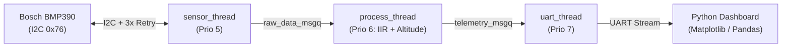

# ZephyrAir

Real-time barometric pressure and temperature sensing firmware written in C on **Zephyr RTOS** for the **Nordic nRF5340**, interfacing with the **Bosch BMP390** sensor over I2C and streaming filtered telemetry to a **Python** visualization dashboard.

## Overview

- **Multithreaded RTOS Pipeline:** Three statically allocated Zephyr threads (`sensor_thread`, `process_thread`, `uart_thread`) communicating via kernel message queues (`k_msgq`).
- **Bosch BMP3 Sensor API Integration:** Uses the official platform-agnostic Bosch `BMP3_SensorAPI` wired to Zephyr's devicetree I2C APIs (`i2c_write_read_dt`, `i2c_write_dt`) with automatic 3x retry and backoff handling.
- **Hardware-Free Simulation (`native_sim`):** Includes a custom register-level BMP390 I2C emulator (`CONFIG_I2C_EMUL`) modeling the `0x60` chip ID, 21-byte NVM factory trim coefficients (`0x31`–`0x45`), 24-bit raw ADC data registers (`0x04`–`0x09`), and runtime I2C `NACK` fault injection.
- **Signal Processing & Unit Tests (`ztest`):** First-order IIR low-pass pressure filter and international barometric altitude calculation verified with Zephyr `ztest` unit tests.
- **Interactive Zephyr Shell:** Runtime CLI commands (`sensor start`, `sensor stop`, `sensor odr <hz>`, `sensor status`, `sensor fault <n>`) for live control and bus diagnostics.
- **Python Telemetry Dashboard:** Live three-panel Matplotlib plot (`Pressure`, `Temperature`, `Altitude`) with high-pressure threshold alerts, automatic CSV logging, and `pandas` offline session replay.

## Architecture



Detailed documentation is available in [`docs/architecture.md`](docs/architecture.md) and [`docs/protocol.md`](docs/protocol.md).

## Repository Structure

```text
ZephyrAir/
├── firmware/
│   ├── boards/
│   │   ├── native_sim_native_64.conf         # Simulator Kconfig (I2C emulator & console)
│   │   ├── native_sim_native_64.overlay      # Simulator devicetree (&i2c0 -> bmp390@76)
│   │   └── nrf5340dk_nrf5340_cpuapp.overlay  # Nordic nRF5340 DK devicetree (&i2c1 -> bmp390@76)
│   ├── src/
│   │   ├── bmp3_api/                         # Official Bosch BMP3 Sensor API
│   │   ├── bmp390_bridge.c / .h              # Zephyr I2C bridge & retry diagnostics
│   │   ├── bmp390_emul.c                     # Register-level BMP390 I2C emulator
│   │   ├── dsp_filter.c / .h                 # 1st-order IIR filter & altitude math
│   │   └── main.c                            # Threads, message queues & Zephyr Shell CLI
│   ├── tests/
│   │   └── src/test_dsp.c                    # Zephyr ztest unit test suite
│   ├── CMakeLists.txt
│   └── prj.conf
├── dashboard/
│   ├── dashboard.py                          # Live Matplotlib viewer & pandas CSV replay
│   └── requirements.txt
└── docs/
    ├── architecture.md
    └── protocol.md
```

## Building and Running

### 1. Simulated Target (`native_sim/native/64`)

```bash
west build -p always -b native_sim/native/64 firmware -d firmware/build
./firmware/build/zephyr/zephyr.exe
```

While the firmware is running, type Zephyr Shell commands directly in the terminal:
```text
sensor stop
sensor status
sensor odr 25
sensor fault 2
sensor start
```

### 2. Nordic nRF5340 Target (`nrf5340dk/nrf5340/cpuapp`)

```bash
west build -p always -b nrf5340dk/nrf5340/cpuapp firmware -d firmware/build_nrf5340
```

**nRF5340 Application Core Memory Footprint:**
- **FLASH:** `66,808 B` / `1 MB` (`6.37%`)
- **RAM:** `16,192 B` / `448 KB` (`3.53%`)

### 3. Running the Unit Tests (`ztest`)

```bash
west build -b native_sim/native/64 firmware/tests -d firmware/build_tests
./firmware/build_tests/zephyr/zephyr.exe
```

### 4. Python Telemetry Dashboard

**Live stream from simulator:**
```bash
./firmware/build/zephyr/zephyr.exe | python3 -u dashboard/dashboard.py --stdin
```

**Replay and analyze a recorded CSV session with `pandas`:**
```bash
python3 dashboard/dashboard.py --replay telemetry_<timestamp>.csv
```

## License

Licensed under the Apache-2.0 License. Bosch BMP3 Sensor API files under `firmware/src/bmp3_api/` are licensed under the BSD-3-Clause License by Bosch Sensortec GmbH.
