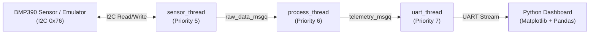

# System Architecture

## Overview

ZephyrAir is a multithreaded barometric pressure and temperature sensing firmware built on Zephyr RTOS. It interfaces with a Bosch BMP390 sensor over I2C using the official Bosch BMP3 Sensor API, filters measurements in a dedicated DSP thread, and streams telemetry over UART to a Python visualization dashboard.

The firmware builds from a single source tree for two targets:
- **`nrf5340dk/nrf5340/cpuapp`** — Nordic nRF5340 ARM Cortex-M33 application core (`&i2c1` hardware peripheral).
- **`native_sim/native/64`** — Linux POSIX simulator paired with a custom register-level BMP390 I2C emulator (`CONFIG_I2C_EMUL`).

## Thread Pipeline

Data flows through three statically allocated Zephyr threads decoupled by two kernel message queues (`k_msgq`):

| Thread | Priority | Stack | Responsibility |
| :--- | :---: | :---: | :--- |
| `sensor_thread` | 5 | 2048 B | Initializes the BMP390 via `bmp390_bridge_init()`, polls sensor data at the configured ODR (default 10 Hz), and pushes `struct raw_sensor_data` into `raw_data_msgq`. |
| `process_thread` | 6 | 1024 B | Blocks on `raw_data_msgq`, applies a first-order IIR low-pass filter (`alpha = 0.15`) to raw pressure, computes barometric altitude, and pushes `struct telemetry_data` into `telemetry_msgq`. |
| `uart_thread` | 7 | 1024 B | Blocks on `telemetry_msgq` and formats `P:<pa>,T:<c>,A:<m>` frames to the console/UART. |

## Hardware Abstraction & Bosch API Integration

The Bosch `BMP3_SensorAPI` (`src/bmp3_api/`) is platform-independent and communicates through three function pointers in `struct bmp3_dev`:
- `dev->read` $\rightarrow$ `bmp390_i2c_read()` (`i2c_write_read_dt` with up to 3 automatic retries and 2 ms backoff)
- `dev->write` $\rightarrow$ `bmp390_i2c_write()` (`i2c_write_dt` with up to 3 automatic retries)
- `dev->delay_us` $\rightarrow$ `bmp390_delay_us()` (`k_usleep`)

## Register-Level BMP390 Emulator (`native_sim`)

When `CONFIG_EMUL=y` is enabled (`boards/native_sim_native_64.conf`), `src/bmp390_emul.c` attaches to `&i2c0` at address `0x76` and models:
- `CHIP_ID` (`0x00` = `0x60`)
- `STATUS` (`0x03`) and `CMD` (`0x7E` soft reset `0xB6`)
- 21 bytes of NVM factory trim coefficients (`0x31`–`0x45`)
- 24-bit uncompensated pressure and temperature registers (`0x04`–`0x09`)
- Interleaved `[reg_addr, reg_data]` burst writes used by `bmp3_set_regs()`
- Runtime I2C `NACK` fault injection via `bmp390_emul_inject_faults()`
